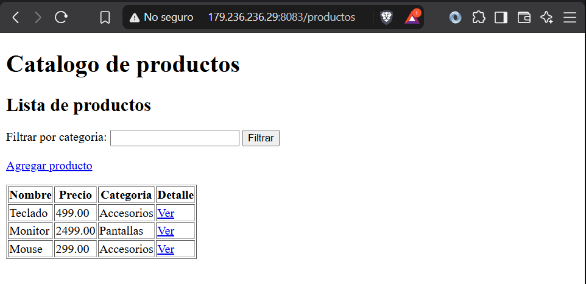
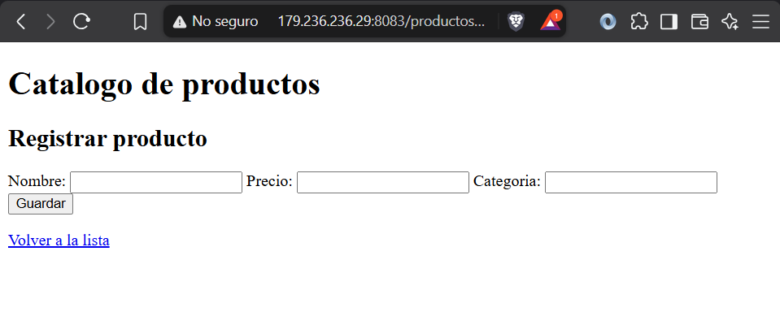
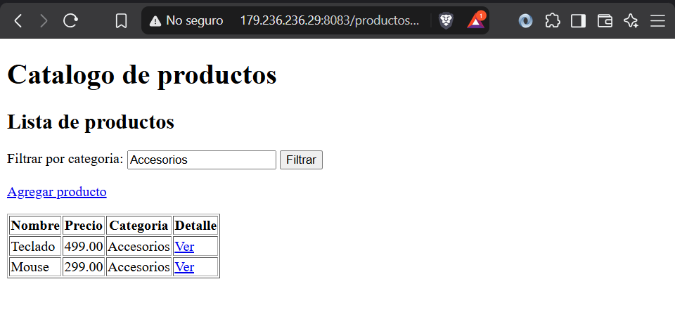
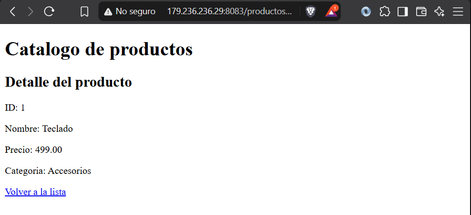
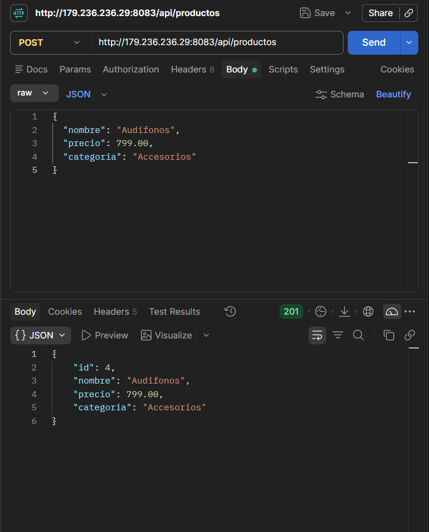

# Act2 Spring - Productos

Martinez Cruz Gael 23161006

Proyecto Spring Boot con vista productos


## Rutas

### Vistas MVC (HTML)

| Funcionalidad | Método y URL |
|---|---|
| Listar productos (`Model` y `th:each`) | `GET /productos` |
| Filtrar por categoría (`@RequestParam`) | `GET /productos?categoria=Accesorios` |
| Ver detalle (`@PathVariable`) | `GET /productos/1` |
| Mostrar formulario | `GET /productos/nuevo` |
| Enviar formulario (`@ModelAttribute`) | `POST /productos/guardar` |


### Endpoint REST (JSON)

| Funcionalidad | Método y URL |
|---|---|
| Crear producto | `POST /api/productos` |

Enviar el cuerpo como `raw` JSON:

```json
{
  "nombre": "Audifonos",
  "precio": 799.00,
  "categoria": "Accesorios"
}
```

## Rutas para las capturas

Guardar las capturas en `docs/capturas/` usando estos nombres:

| Evidencia | Capturas | Página o petición |
|---|---|---|
| Listado con `th:each` |  | `GET /productos` |
| Formulario con `@ModelAttribute` |  | `GET /productos/nuevo` |
| Resultado de `@RequestParam` |  | `GET /productos?categoria=Accesorios` |
| Resultado de `@PathVariable` |  | `GET /productos/1` |
| POST REST probado en Postman o Bruno |  | `POST /api/productos` con respuesta JSON |
